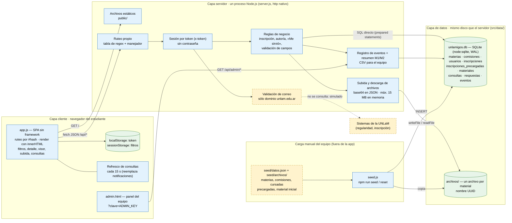
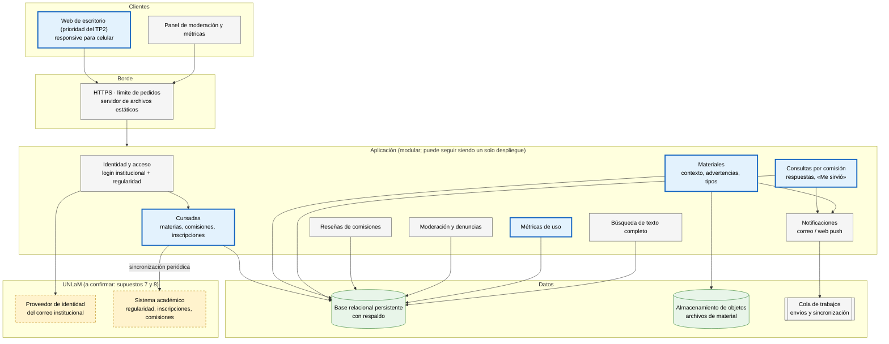

# TP6 — Arquitectura del Sistema · Bananza

- **Repositorio:** https://github.com/gadsii-unlam/gadsii-Bananza
- **Integrantes:** Carlos Antonio Solis Rocha, Franco Kowalski, Iara Sol Rodriguez, Leonardo Barbaro, Maximiliano Caseres
- **Producto:** UNLaMigos

> **Estado.** Los diagramas y la descripción del punto 1 salen de leer `src/` tal como quedó en el commit `b205fd3`, que es el código con el que se hizo la prueba del TP5 (`src/` no cambió después). La tabla del punto 2 es una **propuesta** armada a partir del registro de `docs/prompts.md` (entrada del 25/10/2026) y del historial: la columna «¿La sostendrían hoy?» la tiene que confirmar el equipo, porque esa clasificación no se delega (consigna, punto 7). Los datos de la prueba salen del informe final del TP5 (puntos 5, 6, 9 y 10) y de las fichas y grabaciones de `docs/evidencia/tp5/`.

---

## 1. Arquitectura real del MVP

Es un **monolito de dos capas físicas** (navegador y un proceso Node.js) con **una base SQLite embebida y una carpeta de archivos en el mismo disco**. No hay framework, ni dependencias de npm, ni servicios externos. Todo el backend está en un solo archivo (`server.js`, ~380 líneas): ruteo, autenticación, validación, reglas de negocio, consultas SQL, almacenamiento de archivos y métricas conviven ahí.

**Referencias:** azul = construido · amarillo punteado = simulado o resuelto a mano (según el TP3 y el brief v3) · verde = dónde están los datos.

| Componente | Responsabilidad | Construido / simulado |
|---|---|---|
| `public/app.js` | Toda la interfaz: ruteo por hash, pantallas, filtros por cursada, detalle, visor, subida en 4 pasos, consultas. Guarda el token en `localStorage` y los filtros en `sessionStorage`. | Construido |
| `server.js` — ruteo y sesión | Recibe `/api/*`, autentica por token y despacha. Las rutas `/api/registro` y `/api/catalogo` son públicas. | Construido |
| `server.js` — registro | Acepta cualquier correo que termine en `unlam.edu.ar`; en el primer ingreso copia las cursadas de `inscripciones_precargadas`. | **Simulado:** regularidad e inscripción no se verifican |
| `server.js` — reglas | Sólo inscriptos ven y escriben en las consultas de su comisión; sólo el autor borra su material; sólo quien preguntó marca «Me sirvió». | Construido |
| `server.js` — archivos | Recibe el archivo en base64 dentro del JSON, valida la extensión, lo escribe en disco con nombre UUID y lo sirve con `sandbox` y `nosniff`. | Construido |
| `server.js` — eventos | Guarda eventos de uso y arma el resumen por participante para M1 y M2. | Construido (sólo para la prueba) |
| `db.js` | Esquema SQLite. Se crea al arrancar (`CREATE TABLE IF NOT EXISTS`); no hay migraciones. | Construido |
| `seed.js` + `seed/datos.json` | Carga materias, comisiones, cursadas por correo y material inicial. | **Simulado/manual:** el contenido inicial y los canales los arma el equipo |
| Canales de consultas | No son una entidad: un canal es una comisión. Se «crean» al cargar la comisión en el seed. | **Manual** |
| Notificaciones | No existen; el cliente pide la lista cada 15 s mientras la pantalla está abierta. | Fuera del MVP |

**Dependencias, en una línea:** `app.js → server.js → (db.js → unlamigos.db) y (data/archivos/)`. Nada depende del cliente; el servidor no depende de nada externo. La dirección es siempre de afuera hacia los datos, pero **no hay capas lógicas dentro del servidor**: el manejador de cada ruta valida, decide y escribe SQL en el mismo lugar.

---

## 2. Las decisiones heredadas

Fuente: entrada del 25/10/2026 de `docs/prompts.md` («Decisiones estructurales tomadas por la herramienta, no por el equipo») y el commit `b205fd3`, que agregó todo `src/` de una vez.

| Decisión | ¿Quién la tomó? | ¿La sostendrían hoy? *(a confirmar por el equipo)* | ¿Qué dato del TP2 o de la prueba del TP5 la sostiene o la contradice? |
|---|---|---|---|
| **Los datos viven en SQLite embebido y los archivos en el disco del mismo servidor** (`src/data/`). | La herramienta, para no depender de servicios ni de paquetes. Está registrado en `prompts.md`. | Sí para el MVP; no para la visión. | **La prueba la sostiene:** tres participantes en una sesión, sin errores ni lentitud observados (T1 entre 0:43 y 1:52; los tres tiempos están en las observaciones). **Ningún dato del TP2 la toca:** el relevamiento no habla de volumen ni de concurrencia. Se eligió por comodidad, no por el usuario. La contradice la estimación del brief de 1.500 a 2.500 estudiantes, que pide más de un proceso y copia de respaldo, y la decisión del TP5: el piloto de la v4 arranca sin material precargado, así que lo que se guarde en ese disco serán aportes de estudiantes que no se pueden volver a cargar. |
| **La lógica de negocio está mezclada con el ruteo y el SQL** en un solo archivo (`server.js`); no hay capa de servicios ni de repositorio. | Nadie: salió así. El equipo no lo pidió y la herramienta no lo registra como decisión. | No, si el producto crece; para el MVP no molestó. | **Ningún dato del TP2 ni de la prueba tiene que ver con esto.** Ningún usuario lo puede percibir. Es comodidad de construcción. Pesa al agregar reseñas o integración real, porque la regla «sólo inscriptos» (`exigirInscripcion`) habría que tocarla en cada ruta. |
| **Acceso sin contraseña: correo con dominio `unlam.edu.ar` y un token guardado en el navegador.** | La herramienta, sobre lo que el equipo decidió en el brief v3 (la regularidad se simula). | Sí como simulación; no como acceso real. | **El TP2 la contradice para la visión:** los tres entrevistados valoraron la verificación para evitar spam, intervenciones externas y desinformación (supuesto 2, brief v3). Con este diseño, cualquiera que escriba un correo con ese dominio entra como esa persona. **La prueba la sostiene para el MVP:** el ingreso no generó fricción en ninguna de las tres sesiones. |
| *Opcional:* cliente HTML/JS sin framework con navegación por `#hash`. | La herramienta. | Sí. | **La prueba la sostiene en parte:** U2 «encontró todo con suma facilidad». **La contradice en un punto:** U3 hizo clic en la tarjeta de la materia y «no pasaba nada» (cierre, pregunta 2). Es un problema de interfaz y no de la decisión de usar o no un framework. |

> El equipo debe revisar la columna «¿La sostendrían hoy?» y, si alguien recuerda haber pedido alguna de estas decisiones durante el TP5, corregir la columna «¿Quién la tomó?».

---

## 3. La arquitectura de la gran visión

La visión es la del TP1 (canales por materia y comisión, materiales, reseñas de comisiones, integración con la UNLaM para verificar regularidad e inscripción) más lo que el TP2 sumó (organización por cursada, contexto de cada aporte, notificaciones). La búsqueda de compañeros quedó afuera en el TP2 y no se dibuja.

**Referencias:** recuadro azul grueso = lo que **ya cubre el MVP** (aunque hoy con datos precargados y en un solo archivo) · gris = falta construir · amarillo punteado = sistemas externos a la UNLaM, sin confirmar.

**El salto arquitectónico más grande** es pasar de una **identidad y unas cursadas simuladas** (cualquier correo `@unlam.edu.ar` entra, y las comisiones las carga el equipo en un JSON) a un **acceso verificado contra la UNLaM**. Todo el valor del producto depende de que «tu comisión» sea cierta: los filtros, el aviso de otra cursada y la regla de que sólo los inscriptos escriben en las consultas. Hoy esos datos los pone el equipo a mano. Además, el salto no depende sólo de nosotros: requiere que la Universidad permita una aplicación externa y exponga una forma de verificar alumnos y materias (supuestos 7 y 8 del brief, todavía sin evidencia). Cambiar SQLite por una base servidor o el disco por almacenamiento de objetos es trabajo conocido; la integración institucional es la única pieza que puede bloquear el producto entero.

El orden en que conviene dar los pasos lo marca el TP5: la decisión fue perseverar, y lo próximo es un piloto con una comisión real **sin material precargado** (brief v4). Ese piloto se puede hacer con la identidad todavía simulada, pero no con los archivos en el disco de una máquina del equipo: lo primero que cambia de la arquitectura es dónde se guardan los aportes.

---

## 4. Las tecnologías que agregaría la visión

| Tecnología | Para qué | Por qué |
|---|---|---|
| **Inicio de sesión federado (OpenID Connect) contra el proveedor del correo institucional**, y si no existe, verificación por enlace enviado al correo | Identidad verificada sin guardar contraseñas propias | **Restricción real de la UNLaM:** no sabemos si la Universidad expone una interfaz para aplicaciones externas (supuesto 8). Apoyarse en el correo institucional, que todos los estudiantes ya tienen, es lo único que podemos usar sin un convenio. Responde al TP2: los tres entrevistados quieren verificación para frenar spam y personas externas. La regularidad y la inscripción seguirían sin verificarse hasta tener acceso al sistema académico; mientras tanto, el estudiante declara su comisión, como ya pasa en el MVP. |
| **PostgreSQL** (en un servicio administrado) | Reemplaza a SQLite: varios procesos, respaldo, búsqueda de texto completo en español sin otro motor | **Capacidad de quien la mantiene:** el equipo son cinco estudiantes que rotan; un servicio administrado con copias automáticas evita depender de un disco de una máquina del equipo, que es como se corrió la prueba. El esquema actual es relacional y pasa casi sin cambios. **También por familiaridad:** es la base que el equipo vio en la carrera, y lo declaramos así. |
| **Almacenamiento de objetos compatible con S3** con subida directa desde el navegador | Archivos de material fuera del servidor de aplicación | El contexto de uso del TP2 son apuntes y modelos de parciales en PDF, imágenes y Office: archivos chicos pero muchos y que se acumulan cuatrimestre a cuatrimestre. Hoy pasan enteros por la memoria del servidor en base64 (ver punto 5). |

Se queda **Node.js**: el equipo ya lo conoce y el MVP lo usa. Es una elección por familiaridad, no técnica.

---

## 5. El componente más riesgoso

**La subida y el almacenamiento de archivos de material** (`POST /api/materiales`, el formulario «Subir material» de `app.js` y la carpeta `data/archivos/`).

**1. Es lo único que dio error durante la prueba, y lo que el informe del TP5 contó mal.** En la pregunta de cierre 4, U1 dijo: «Intenté subir un archivo de Excel, pero la plataforma no me lo permitió». El informe del TP5 lo tomó como un rechazo del Excel sin causa identificada (puntos 5, 6 y 9). Revisamos la grabación `docs/evidencia/tp5/U1-sesion/t4.mkv` y lo que pasó fue otra cosa:

| Minuto de `t4.mkv` | Qué se ve |
|---|---|
| 0:45–1:05 | U1 completa el formulario y elige `Mi Bandoneon.sf2` (un archivo de sonido, 4,74 MB). |
| ~1:05 | Al publicar, el formulario avisa «Completá el campo “Contexto del aporte”». Escribe «AAAAAAAAAAAAAAAAAA». |
| ~1:10 | El servidor rechaza el archivo: «No se admiten archivos .sf2. Usá PDF, imagen, texto u Office». |
| 1:15–1:20 | Cambia el archivo por `LEGAJO PERSONAL.XLS` (0,11 MB). No llega a publicarlo. |
| ~1:21 | Lo vuelve a cambiar por un `.txt` con código SQL y publica. Aparece «Publicaste el material. ¡Gracias por compartir!». |

El Excel nunca se envió. Lo que se rechazó fue el `.sf2`, y el rechazo era correcto. El componente funcionó, pero el participante salió convencido de que no lo dejaba subir lo que quería. Que el error no se entienda, o se recuerde distinto, es justo lo que hace que alguien deje de aportar.

**2. Es el componente que sostiene la parte de la hipótesis que quedó sin probar.** El TP5 decidió perseverar, y lo próximo es que el material lo suban los estudiantes, en un piloto sin material precargado (brief v4). Si subir falla o confunde, el contenido no crece y la búsqueda (M1) no tiene qué encontrar. U3 lo dijo en el cierre 3: «todo depende de la cantidad de contenido de la plataforma».

**3. Además, la grabación muestra que no hay control sobre lo que se sube.** El único aporte de U1 fue un archivo de prueba. El título y el contexto dicen «AAAA…», y la advertencia que escribió el propio U1 dice «No tiene mucho que ver con la materia». Quedó publicado como parcial de Sistemas Operativos, visible para toda la comisión. En una prueba no importa, pero en el piloto ese material se mezcla con el de verdad. Tampoco hay revisión de contenido: la extensión se valida sólo por el nombre.

**4. Es el que peor escala tal como está hecho hoy:**
- el archivo viaja dentro del JSON en base64 (un tercio más grande) y el servidor lo junta entero en memoria antes de escribirlo. Unas pocas subidas simultáneas de material grande pueden dejar sin memoria al único proceso, y con él a toda la app. El límite tampoco es coherente: el cliente corta en 10 MB y el servidor admite 15 MB *de base64*, que son unos 11 MB reales;
- los archivos están en el disco del mismo servidor y sin copia. Si se pierde la máquina, o si el hosting no tiene disco persistente (lo advierte `src/README.md`), se pierden todos los aportes. No se pueden reconstruir, porque los subieron los estudiantes.

Para comparar: la base SQLite también es un punto único, pero con 1.500 a 2.500 estudiantes y textos cortos aguanta bastante más. El registro simulado es el salto más grande (punto 3), pero no es un componente que vaya a *fallar*: es uno que todavía no existe.

---

## 6. Brief de producto — versión 5

Ver [`docs/brief.md`](../brief.md), versión 5. Abre con el párrafo de cambios respecto de la v4 y agrega tres secciones: la arquitectura del MVP y de la visión, las restricciones técnicas del contexto y el riesgo técnico principal. También corrige lo que la v4 decía sobre el Excel de U1, según la grabación revisada en el punto 5.

---

## 7. Sobre el uso de IA

Registro en [`docs/prompts.md`](../prompts.md), entrada del 10/11/2026 (TP6).

- **Delegado:** dibujar los dos diagramas en Mermaid, ordenar la documentación, explorar las tecnologías del punto 4, redactar el borrador de los puntos 3 a 6 y extraer cuadros de la grabación `t4.mkv` de U1 para ubicar en qué minuto pasó cada cosa del punto 5.
- **No delegado / a confirmar por el equipo:** la clasificación del punto 2. La herramienta la propuso a partir de lo que el propio equipo registró el 25/10/2026 en `prompts.md`, pero la columna «¿La sostendrían hoy?» y cualquier corrección sobre quién tomó cada decisión las decide el equipo. La lectura del código para la arquitectura real (punto 1) también la tiene que validar alguien del equipo contra `src/`.
