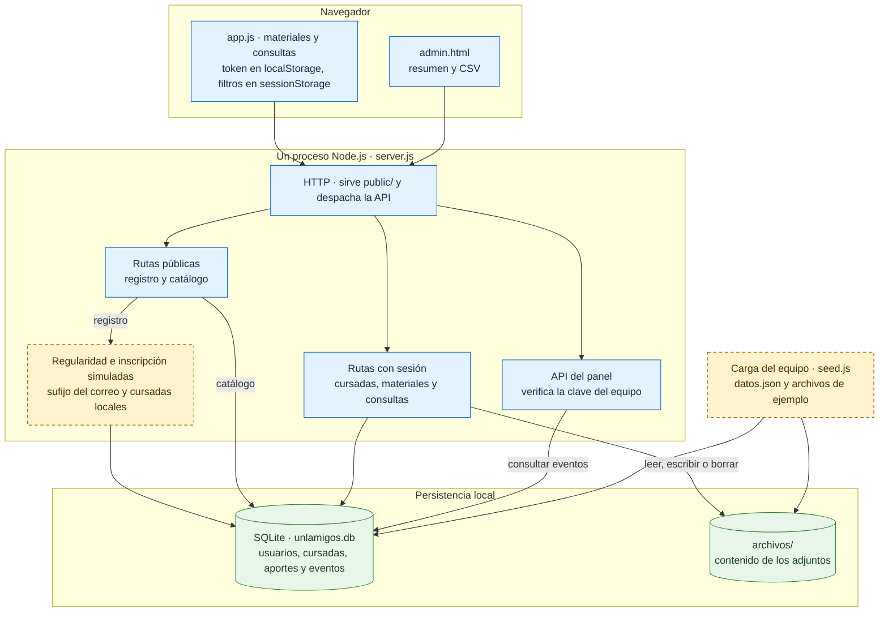
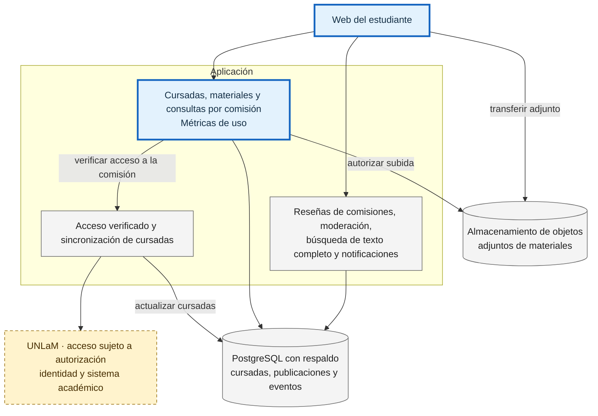

# TP6 — Arquitectura del Sistema · Bananza

- **Repositorio:** https://github.com/gadsii-unlam/gadsii-Bananza
- **Integrantes:** Carlos Antonio Solis Rocha, Franco Kowalski, Iara Sol Rodriguez, Leonardo Barbaro, Maximiliano Caseres
- **Producto:** UNLaMigos

## 1. Arquitectura real del MVP

El navegador y un único proceso Node.js forman las dos capas físicas. `server.js` sirve la interfaz y concentra el ruteo HTTP, la sesión, las reglas de negocio y las consultas SQL. `db.js` abre SQLite, crea el esquema y prepara la carpeta de adjuntos. Ambos almacenes están bajo `DATA_DIR` (por defecto, `src/data/`).

Azul indica componentes construidos, amarillo punteado identifica simulaciones o cargas manuales y verde marca los datos persistentes. Cada flecha va de quien usa un recurso hacia ese recurso.

- **Ingreso y catálogo.** El catálogo consulta materias y comisiones sin exigir sesión. El registro comprueba el formato y el sufijo del correo, entrega un token y, al crear un usuario, copia sus cursadas precargadas. El estudiante también puede elegirlas o cambiarlas. La UNLaM no interviene en ese flujo.
- **Materiales y consultas.** El servidor valida el token para leer o publicar. Cada material guarda sus metadatos en SQLite y puede tener un enlace o un adjunto en disco. Las consultas y respuestas sí exigen inscripción local en la comisión. La pantalla de consultas se refresca cada 15 segundos.
- **Archivos y métricas.** El visor y la descarga usan la sesión del estudiante, que puede viajar en la URL del archivo. El panel usa su propia clave para leer el resumen M1/M2 y exportar los eventos en CSV.

## 2. Dos decisiones heredadas

El registro del 25/10/2026 atribuye las dos elecciones de implementación a Claude Code (Claude Opus 5.5). El equipo ya había definido en el TP3 que simularía la regularidad. El equipo confirmó la atribución de ambas decisiones y en qué condiciones las sostendría.

| Decisión del MVP | ¿Quién la tomó? | ¿La sostendrían hoy? | Evidencia del TP2 o TP5 |
|---|---|---|---|
| Guardar metadatos en SQLite y adjuntos en el mismo disco. | La herramienta. | Para la prueba, sí. Para el piloto, conservar los aportes con respaldo recuperable. | En T1, U1 encontró el parcial en 1:31, U2 en 0:43 y U3 en 1:52. Esa tarea midió recuperación de material. Ninguna sesión probó concurrencia ni recuperación ante pérdida del disco. |
| Entregar una sesión por correo institucional declarado, sin contraseña. | La herramienta. | Para simular el ingreso, sí. Para la visión, verificar identidad e inscripción. | En el TP2, U1 valoró la verificación para reducir desinformación y U3 para evitar spam de personas externas. Comprobar sólo el texto del correo deja abierta esa necesidad. |

## 3. Arquitectura de la gran visión

El contorno azul marca lo que ya cubre el MVP. El gris identifica componentes propuestos y el amarillo, la dependencia institucional por confirmar. Las reseñas recuperan una función central del TP1. Las notificaciones responden al interés relevado en el TP2.

**El mayor salto es acreditar que el usuario pertenece a la comisión.** Hoy el permiso para intervenir en consultas depende de una cursada precargada o declarada. En la visión, el sistema debe identificar a la persona y consultar una fuente académica de regularidad e inscripción. La confianza que pidieron los entrevistados depende tanto de esos datos como de la autorización para usarlos.

## 4. Tecnologías que agregaría la visión

| Tecnología propuesta | Qué resuelve y por qué |
|---|---|
| OpenID Connect | Permitiría iniciar sesión con el proveedor institucional si la UNLaM admite la aplicación. La condición de alumno regular y la comisión requieren además datos académicos. Los supuestos 7 y 8 del brief siguen abiertos. |
| PostgreSQL administrado | Mantiene las relaciones entre materias, comisiones y aportes. Un servicio con copias y restauración reduce el trabajo operativo del equipo de estudiantes. La preferencia por PostgreSQL también responde a la familiaridad declarada en el borrador. |
| Almacenamiento de objetos compatible con S3 | El servidor autoriza la subida y el navegador transfiere el adjunto directamente. Así, apuntes y parciales pueden conservarse fuera del disco de la aplicación, con una política de respaldo y recuperación. |

## 5. Componente más riesgoso

**Subida y conservación de materiales.** En la exploración libre del TP5, U1 quiso aportar un archivo. En el cierre recordó que se había rechazado un Excel. La secuencia registrada en T4 permite identificar dónde apareció la confusión.

| Momento aproximado | Qué ocurrió en la sesión de U1 |
|---|---|
| 1:05–1:11 | Después de completar el contexto obligatorio, intentó publicar un archivo de sonido con extensión .sf2. El servidor informó que el formato no se admitía. |
| 1:15–1:28 | Seleccionó un .xls, lo reemplazó antes de enviarlo y publicó un .txt. |

El rechazo era el previsto, pero U1 terminó la sesión con una idea equivocada sobre qué podía compartir. Además, el archivo de prueba quedó publicado como parcial. El formulario comprueba los campos y la extensión, mientras que la pertinencia del contenido queda a cargo de quien lo sube. En un piloto que empieza sin material precargado, esas dos fricciones afectan tanto la cantidad de aportes como su utilidad.

Al crecer el uso, cada subida ocupa memoria en el mismo proceso que atiende las consultas. El navegador limita el archivo a **10 MiB** y lo codifica en base64. El servidor limita a **15 MiB el cuerpo JSON completo**, después decodifica el adjunto y lo escribe en disco. El repositorio no incluye un procedimiento de respaldo de esos archivos. Son riesgos de concurrencia y pérdida de datos pendientes de medir. El TP5 documenta la confusión de U1, sin registrar una caída por carga.

Evidencia: [grabación de U1, T4](../evidencia/tp5/U1-sesion/t4.mkv) y [respuesta de cierre 4](../evidencia/tp5/U1-sesion/observacion.md).

## 6. Brief de producto, versión 5

El [brief v5](../brief.md) abre con los cambios respecto de la v4. Incorpora el paso de cursadas simuladas a verificadas, las restricciones institucionales y de mantenimiento, y el riesgo de perder aportes en el piloto.

## 7. Uso de IA y validación del equipo

El [registro de IA](../prompts.md) identifica la asistencia en los diagramas, la redacción, las alternativas tecnológicas y la revisión documental. La herramienta también intervino en el borrador de los puntos 1 y 2. El equipo confirmó las dos decisiones del punto 2. Queda pendiente que un integrante valide el diagrama del MVP contra el código.
