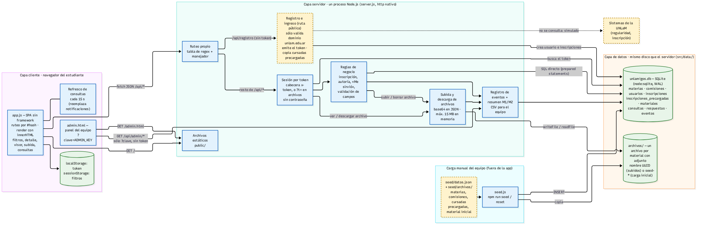

# TPI · Trabajo Práctico Integrador

**Universidad Nacional de La Matanza** · Departamento de Ingeniería e Investigaciones Tecnológicas
Ingeniería Informática · Gestión Aplicada al Desarrollo de Software II (3665)

**Grupo:** Bananza · **Producto:** UNLaMigos

| | |
|---|---|
| **Repositorio** | https://github.com/gadsii-unlam/gadsii-Bananza (línea base `tpi-entrega`) |
| **Producto (MVP)** | [completar URL pública del MVP] · cómo correrlo local: `README.md` del repositorio |
| **Fecha de entrega** | martes 24/11/2026 |

| DNI | Integrante |
|---|---|
| 42214067 | Carlos Antonio Solis Rocha |
| 41893248 | Franco Kowalski |
| 42247089 | Iara Sol Rodriguez |
| 42375507 | Leonardo Barbaro |
| 41708808 | Maximiliano Caseres |

**Cómo leer este documento.** Cada afirmación remite a un archivo o a un commit del repositorio. Los commits se citan por su hash corto (por ejemplo `4b2373f`); las líneas base, por su tag (`tp1-entrega` … `tpi-entrega`). Las citas de usuarios son textuales y llevan el archivo del que salen.

## Parte 1 — El documento integrador

### 1. El arco

El brief tiene cinco versiones en `docs/brief.md`. Las leímos commit por commit:

| Versión | Commit · fecha | TP | Qué la provocó |
|---|---|---|---|
| v1 | `4b2373f` · 29/08 | TP1 | Primera definición del producto. |
| v2 | `5a0e3df` · 02/09 | TP2 | Las tres entrevistas (U1, U2, U3). |
| v3 | `a3f0269` · 08/09 | TP3 | Recorte del MVP: qué se construye y qué se simula. |
| v4 | `9cf7fa1` · 09/11 21:50 | TP5 | La prueba del MVP del 3/11. |
| v5 | `b2d1fd8` · 09/11 22:19 | TP6 | La arquitectura y la revisión de la grabación de U1. |

Lo primero que muestra el historial: entre la v3 (8/09) y la v4 (9/11) pasaron dos meses sin un solo cambio en el brief, aunque en el medio hubo una evaluación de usabilidad (TP4) y se construyó el MVP. Además, la v4 y la v5 se commitearon con 29 minutos de diferencia, la misma noche, y las dos se retocaron después (`46de60a` el 11/11 y `a9fedd1` el 17/11). Es decir: el brief registró bien agosto y septiembre, pero lo aprendido en octubre se escribió todo junto y después. Lo declaramos porque la consigna pide leer el historial como registro objetivo, y ese registro tiene un hueco de dos meses.

#### Qué creíamos en agosto (v1, `4b2373f`)

- **El producto.** «UNLaMigos es una **aplicación social** para estudiantes de Ingeniería en Informática de la UNLaM». El problema era «la dispersión de la información y de los puntos de contacto entre estudiantes». Tenía tres funciones core: canales de contacto por materia y comisión, compartir archivos y apuntes, y **reseñar y recomendar comisiones**. Integración con el sistema de la UNLaM para verificar al alumno regular.
- **El usuario que suponíamos.** Tres grupos: quien busca información, quien comparte recursos y **quien busca compañeros de grupo**. El primario era quien busca información, declarado «todavía hipotético».
- **Los supuestos.** Ocho. El crítico: «a los estudiantes les resulta molesta la dispersión de información […] entre medios como Discord y WhatsApp». Los otros: que valoran la verificación «para evitar suplantaciones», que hay frustración al buscar compañeros, que evitan las plataformas oficiales por miedo a exponerse, que los avanzados aportan sin compensación, que adoptarían una app centralizada, y dos institucionales (que la UNLaM permite apps externas y que tiene interfaces para verificar alumnos).

#### Qué sabemos en noviembre (v5, `b2d1fd8` / `a9fedd1`)

- **El producto que quedó.** Ya no es una «aplicación social». Es un **espacio de materiales organizados por materia, comisión y cuatrimestre**, donde cada aporte lleva su contexto y sus advertencias, más un canal de consultas por comisión. Las reseñas y la búsqueda de compañeros salieron del MVP. La identidad está simulada.
- **El usuario real.** Cursa varias materias, trabaja, estudia en ventanas cortas entre el trabajo y la cursada, y busca **desde la computadora, en su casa** (los tres entrevistados). Usa WhatsApp, MIeL y Discord según la necesidad, sin un recorrido único. Los tres están en etapas intermedias o avanzadas, no en primer año.
- **Qué supuestos sobrevivieron y cuáles no** (tabla «Estado de los supuestos del TP1» del brief v5):

| Supuesto del TP1 | Qué pasó |
|---|---|
| 1. La dispersión molesta (crítico) | **Sobrevivió, a medias:** 2 de 3. U1 lo contradice: «no siento que falte centralizar la información» (`docs/evidencia/tp2/entrevista_U1.md`). |
| 2. Verificación para evitar suplantaciones | **Sobrevivió con otro motivo:** los tres la quieren, pero contra spam, gente de afuera y desinformación, no contra suplantación. |
| 3. Frustración al buscar compañeros | **Cayó** (2 de 3). U1: «Dificultad para encontrarlo no; la dificultad es que después el grupo funcione». |
| 4. Miedo a exponerse en plataformas oficiales | **Sobrevivió con matices:** la exposición es ante los docentes, no ante los pares (U3). |
| 5. Los avanzados aportan sin compensación | **Sobrevivió en el único caso posible** (U3, 1 de 1). |
| 6. Adoptarían una app centralizada | **Sólo declarativo** (3 de 3 dijeron que sí). En el TP5 no se preguntó si la usarían en lugar de sus canales. |
| 7 y 8. La UNLaM permite apps externas y expone interfaces | **Sin evidencia después de doce semanas.** Nunca hicimos la consulta institucional. |

Y aparecieron supuestos que en agosto no existían: que el uso es de escritorio, que contexto y advertencias motivan a aportar (U1) y, sobre todo, el que hoy consideramos el más riesgoso: que **el material lo suban los propios estudiantes, sin que lo cargue el equipo**. U3 lo dijo en la prueba: «todo depende de la cantidad de contenido de la plataforma» (`docs/evidencia/tp5/U3-sesion/observaciones.md`).

Hay un cambio que el brief hizo sin evidencia nueva. En la v3 el usuario primario pasó a ser «especialmente quien cursa **sin grupos ni contactos**». Ninguno de los tres entrevistados encaja del todo en ese perfil (U1 arma grupo con conocidos, U3 es avanzada y comparte material), y en el TP5 las fichas no registraron si los participantes cursaban sin contactos. El usuario primario de noviembre es una inferencia razonable, pero no está observado.

#### El momento en que más cambió el rumbo

**El TP2, entre la v1 (29/08) y la v2 (02/09).** En cuatro días el producto pasó de «aplicación social que centraliza» a «material organizado por cursada, con contexto». Lo provocaron tres citas de las entrevistas:

1. U1, sobre los grupos de WhatsApp: entra gente de otra comisión y «tiran comentarios, fechas o temas de otra comisión». Centralizar no alcanza: si se mezcla, el problema sigue. De ahí sale **organizar por materia, comisión y cuatrimestre**, que es la columna vertebral de todo lo que vino después (los filtros precargados, el aviso de «otra cursada», la regla de que sólo los inscriptos escriben en las consultas).
2. U1, sobre por qué no sube apuntes a un lugar abierto: «se arme una ola y se comparta información con errores, una catarata de desinformación», y que los subiría «siempre que se pueda poner una advertencia tipo "ojo con esto"». De ahí salen **el contexto y las advertencias de cada aporte**.
3. U1 y U2 encuentran compañeros sin dificultad. La **búsqueda de compañeros** se cae como necesidad principal y, con ella, un tercio del producto de agosto.

El segundo momento importante fue la v4, aunque ahí no cambió el producto sino la hipótesis. La prueba del TP5 dio «se sostiene», pero entendimos que habíamos probado algo más chico de lo que creíamos: el producto funciona **cuando el material ya está cargado y alguien responde**, y esas dos condiciones las pusimos nosotros. La hipótesis v4 pone en el centro que «los mismos estudiantes suben el material».

### 2. El estado del producto

**Qué es.** UNLaMigos es una aplicación web para estudiantes de Ingeniería en Informática de la UNLaM. Permite encontrar y compartir apuntes, parciales, finales y bibliografía ordenados por materia, comisión y cuatrimestre, cada uno con su contexto y sus advertencias, y hacer consultas a estudiantes de la misma comisión. **Problema:** conseguir material y respuestas cuesta tiempo y depende de conocer el canal o a la persona correcta. U3: «a veces pasás más tiempo buscándolo que leyéndolo» (`entrevista_U3.md`). **Para quién:** el estudiante que busca información; quienes aportan material son el grupo que lo sostiene.

#### Qué está construido, qué quedó simulado y qué quedó diferido

| Construido y funcionando (`src/`) | Simulado o resuelto a mano | Diferido |
|---|---|---|
| Ingreso con correo institucional en dos pasos (correo y nombre) | La regularidad: sólo se controla que el correo termine en `unlam.edu.ar` | Integración real con la UNLaM (identidad e inscripción) |
| «Mis materias» con comisión y cuatrimestre, y cambio de cursadas | Las cursadas: precargadas por correo en `src/seed/datos.json` o elegidas por el propio estudiante | Reseñas de comisiones |
| Materiales con filtros precargados, tipos con cantidad, listado con contexto, detalle lateral, visor de PDF, imagen y texto, y descarga | El material inicial y las comisiones: los carga el equipo con `seed.js` | Notificaciones (hoy la lista de consultas se refresca cada 15 s) |
| Aviso y confirmación antes de descargar material de otra cursada o con advertencia | Los canales de consulta: cada comisión del seed es un canal | Moderación y revisión de lo que se sube |
| Subida de material en cuatro pasos, con contexto y advertencias; borrar el propio aporte | | Búsqueda de compañeros, app móvil nativa, uso sin conexión |
| Consultas por comisión: publicar, responder y marcar «Me sirvió» | | Respaldo de los archivos subidos |
| Registro de eventos y panel del equipo (`/admin.html`) para M1 y M2 | | |

Lo comprobamos el 21/11 en la línea base del TPI: `npm run reset` carga 6 materias, 9 comisiones y 10 materiales de ejemplo, y el servidor arranca y responde el catálogo y el registro.

#### La prueba con usuarios del TP5 y qué hicimos con ella

El 3/11 probamos el MVP con U1, U2 y U3 (los mismos del TP2) en una comisión simulada, la 2300. Las seis tareas y las fichas están en `docs/evidencia/tp5/`, con las grabaciones de cada tarea.

| Criterio (escrito en `docs/metricas.md`) | Resultado | Lectura honesta |
|---|---|---|
| **M1:** encontrar material de su comisión en < 5 min, sin ayuda ni otra plataforma (umbral 2 de 3) | 3 de 3. T1 en 1:31 (U1), 0:43 (U2) y 1:52 (U3) | Medido con el cronómetro del observador. El registro del MVP no se exportó, así que no está cruzado con el panel, como pedía la propia métrica. |
| **M2:** una consulta con respuesta útil de un par desconocido de la misma comisión | 1 consulta: U3 respondió la de U2 a los 10 min y U2 marcó «Me sirvió» | La respuesta la pedía la consigna de la tarea T6. Prueba que el flujo funciona, no que alguien responda sin que se lo pidan. |
| Aporte espontáneo de material | U1 y U3, según las fichas | Lo de U1 fue un archivo de prueba: título «AAAA…» y su propia advertencia, «No tiene mucho que ver con la materia» (`U1-sesion/t4.mkv`). Señal débil. |
| Identificar comisión y cuatrimestre sin abrir el material | 3 de 3 en T5 | Cumplido. |

**Decisión: perseverar.** El resultado cae en la fila «Se sostiene» del criterio de éxito. Aparecieron cuatro problemas de interfaz, ninguno bloqueante: la tarjeta de la materia no responde al clic (U3), la materia actual se confunde con la comisión (U1), las etiquetas de texto libre (U1) y el mensaje de formato no admitido. Este último lo contamos mal en el TP5: U1 dijo en el cierre «Intenté subir un archivo de Excel, pero la plataforma no me lo permitió». En el TP6 revisamos la grabación y el rechazado fue un `.sf2`. El Excel nunca se envió (corregido en la v5).

**Qué hicimos con el resultado.** Lo escribimos en el brief v4: una hipótesis nueva, un piloto de varias semanas con una comisión real y sin material precargado, y cuatro cambios de interfaz. **Lo que no hicimos:** ninguno de esos cuatro cambios llegó al código. El código de `src/` no cambia desde el commit `b205fd3` del 26/10 (después sólo se tocó su README), y el piloto no se hizo. El resultado del TP5 cambió el documento, no el producto.

#### La arquitectura

*Azul: construido. Amarillo punteado: simulado o cargado a mano. Verde: dónde viven los datos. Fuente: diagrama del PDF entregado en el TP6 (`docs/arquitectura/diagrama-mvp.png`); la versión en Mermaid, con la descripción de cada componente, está en `docs/arquitectura/tp6-arquitectura.md`.*

Es un monolito de dos capas físicas: el navegador y un único proceso Node.js (`server.js`, unas 380 líneas, sin framework ni dependencias de npm). Ese proceso sirve la interfaz, la API JSON y el panel del equipo. Los datos van a una base SQLite embebida (`node:sqlite`) y los archivos a una carpeta del mismo disco. Nada depende de un sistema externo: la UNLaM no se consulta. La visión agrega identidad verificada contra la UNLaM, PostgreSQL administrado y almacenamiento de objetos (diagrama en `docs/arquitectura/diagrama-vision.png`).

### 3. Las decisiones

| Decisión | Qué la fundamentó | Qué se resignó | ¿La sostenemos hoy? |
|---|---|---|---|
| **1. Organizar todo por materia, comisión y cuatrimestre**, con contexto y advertencias en cada aporte (TP2, v2). | U1: en los grupos «tiran comentarios, fechas o temas de otra comisión»; y subiría apuntes «siempre que se pueda poner una advertencia» (`entrevista_U1.md`). | La «aplicación social» de agosto: el producto pasó a ser un repositorio con consultas, no una red. | **Sí.** Es lo que mejor funcionó en la prueba: en T5 los tres eligieron un material de su cursada e identificaron comisión y cuatrimestre sin abrirlo. |
| **2. Sacar del MVP la búsqueda de compañeros y las reseñas** (TP2 y TP3, v2 y v3). | Supuesto 3 refutado: U1 y U2 encuentran grupo sin dificultad. Las reseñas no las medía ningún criterio de la hipótesis. | Una de las tres funciones core del TP1 (las reseñas) y uno de los tres grupos de usuarios. | **Sí, con matices.** Las reseñas tienen uso real: U3 deja opiniones de materias por Discord y U2 mira el Excel de reseñas de profesores. Volverían después del piloto, no antes. |
| **3. Simular la identidad:** correo declarado con sufijo `unlam.edu.ar`, sin contraseña ni verificación (TP3; implementación de la herramienta de IA, TP5). | La integración real no era necesaria para probar la hipótesis (v3). Los supuestos 7 y 8 no tenían evidencia. | La verificación, que es lo que los tres entrevistados pidieron (contra spam y gente de afuera). | **Como simulación, sí. Como está implementada, no.** Cualquiera que escriba el correo de otro entra con su sesión, y el control acepta `x@noesunlam.edu.ar` (ver punto 4). Para el piloto pondríamos al menos verificación por enlace al correo. |
| **4. Probar el MVP con material precargado por el equipo y con la respuesta entre pares pedida por consigna** (TP5, guion de la sesión). | Una sesión de una hora necesita material que encontrar y una consulta que responder. El borrador de M2 (26/10) daba 48 h para que llegara una respuesta; el 1/11 la pasamos a la misma sesión, de T2 a T6, y sacamos el seguimiento de 48 h (`eb765e9`). | Probar el supuesto más riesgoso: que los estudiantes aporten y respondan por su cuenta. | **No: es la que hoy cambiaríamos.** Hicimos que la prueba saliera bien por diseño. El «se sostiene» del TP5 dice que la interfaz funciona, no que el producto tenga contenido ni respuestas en uso real. Hoy probaríamos primero el aporte: una comisión real, una semana, sin material cargado. |
| **5. Perseverar después del TP5** (v4). | M1 dio 3 de 3 contra un umbral de 2, hubo 1 consulta útil y los problemas fueron de interfaz, no de valor. | El pivote que el brief deja escrito: si las consultas no reciben respuesta sin que nadie lo pida, zoom-in a materiales y se saca el canal de consultas. | **Sí, pero condicionada.** Perseveramos sobre una prueba que no midió lo que más importaba (decisión 4). La decisión correcta es «perseverar hasta el piloto», y el piloto no se hizo. |

### 4. Qué falta

#### Qué habría que construir que hoy está simulado

1. **Identidad verificada.** Como mínimo, verificación por enlace al correo institucional. Lo ideal es el inicio de sesión con el proveedor del correo de la UNLaM, si la Universidad lo autoriza (supuestos 7 y 8, todavía sin consultar).
2. **Cursadas reales.** Hoy las precarga el equipo o las declara el estudiante. Para que «tu comisión» sea un dato cierto hace falta una fuente académica, y eso no depende de nosotros.
3. **Altas de materias, comisiones y canales** desde una administración, no editando `seed/datos.json`.
4. **Notificaciones** de consultas y respuestas. En el TP5, la única respuesta llegó porque U2 y U3 estaban en el mismo bloque. Fuera de una sesión, nada avisa.
5. **Moderación:** denunciar o despublicar un material. El archivo de prueba de U1 quedó publicado como parcial de Sistemas Operativos.

#### El riesgo del TP6 que habría que resolver primero

**La subida y el almacenamiento de archivos** (`POST /api/materiales`, `data/archivos/`). Es el componente del que depende el piloto: si subir falla o confunde, el contenido no crece y la búsqueda no tiene qué encontrar. Hoy:

- el archivo viaja en base64 dentro del JSON y el único proceso lo junta entero en memoria;
- los aportes quedan en el disco del servidor **sin copia**, y no se pueden reconstruir porque los subieron los estudiantes;
- no hay revisión del contenido; la extensión se valida sólo por el nombre;
- el mensaje de rechazo no evitó que U1 saliera convencido de que no podía subir un Excel.

Primero: respaldo automático, o almacenamiento de objetos con versionado. Después: subida directa, sin pasar por la memoria del proceso. Y un mensaje de error que diga qué formatos sí se aceptan.

#### Quién lo mantendría y qué necesitaría

La restricción la escribimos en el brief v5: el producto lo sostiene **un equipo de estudiantes que rota**. Para la UNLaM vemos dos opciones, y ninguna está consultada:

- **Una agrupación o el centro de estudiantes de Informática.** Es la que tiene sentido para el producto: el usuario y el mantenedor son la misma comunidad. Necesitaría:
  - **documentación:** el `README.md` de esta línea base (qué es, cómo se corre, cómo se continúa y qué está roto) y una guía de operación: respaldo, restauración y rotación de la clave del panel;
  - **accesos:** la organización `gadsii-unlam` en GitHub, el hosting, el dominio, las variables `ADMIN_KEY` y `DATA_DIR`, en un gestor compartido y no en la máquina de un integrante;
  - **capacitación:** alcanza con Node.js y SQL, que se ven en la carrera; ese fue el motivo para no sumar un framework;
  - **presupuesto:** un hosting chico con disco persistente y respaldo, o un servicio administrado. Es poco dinero, pero alguien tiene que pagarlo todos los meses.
- **Un área de la Universidad** (sistemas del Departamento). Es la única que podría dar la integración real. A cambio, el producto deja de ser «de los estudiantes» y queda sujeto a la normativa institucional. Además, publicar parciales y material de cátedra necesita una autorización que hoy no tenemos.

Sin ninguno de los dos, el producto muere al terminar el cuatrimestre, como cualquier grupo de WhatsApp de una camada.

#### La deuda técnica: cuál fue deliberada y cuál no

| Deuda | ¿Deliberada? |
|---|---|
| Identidad y cursadas simuladas | **Sí.** Decidida en el TP3: la prueba no medía la integración. |
| SQLite y archivos en el mismo disco, sin respaldo | **A medias.** La eligió la herramienta de IA para no depender de servicios. La aceptamos para la prueba, no para el piloto (TP6). |
| Sin notificaciones; consultas que se refrescan cada 15 s | **Sí.** Notificaciones fuera del MVP desde la v3. |
| Todo el backend en un archivo: ruteo, reglas y SQL mezclados, sin migraciones | **No.** Salió así; nadie lo decidió (TP6, punto 2 del PDF entregado). |
| Sin pruebas automáticas | **No.** No hay ni una. |
| Subida en base64 dentro del JSON, y límites incoherentes: el cliente corta en 10 MB, el servidor admite 15 MB y el error dice «máximo 10 MB» | **No.** |
| Sesión sin contraseña: el token no rota, se reentrega a quien escriba el correo y viaja en la URL de los archivos (`?t=`) | **No** como implementación. La simulación sí era deliberada; dar la sesión de otro a quien sepa su correo, no. |
| El control del dominio usa `endsWith('unlam.edu.ar')` y acepta, por ejemplo, `x@noesunlam.edu.ar` | **No.** Lo encontramos al preparar el TPI (`src/server.js`, ruta `/api/registro`). |
| La clave del panel viaja en la URL (`?clave=`) | **No.** |
| Los cambios de interfaz que salieron del TP5 (brief v4) no están construidos | **No.** Quedaron escritos y nunca se implementaron. |

### 5. La retrospectiva del trabajo con IA

El registro está en `docs/prompts.md`. Tiene 11 entradas entre el 28/08 y el 17/11, con ChatGPT, Codex, Gemini y Claude Code. Antes de responder, un límite: el registro **no está completo**. No hay entradas del TP2, del TP4 ni del TP7, aunque `docs/evaluacion/evaluacion-ia.md` dice que la evaluación heurística del TP4 se «generó con IA (Claude)». Las tres entradas de exploración del TP3 se reconstruyeron después, «a partir del relato del integrante». Lo que sigue se apoya sólo en lo que está registrado.

#### Dónde la IA nos ahorró trabajo real

- **El MVP entero (25 y 26/10, Claude Code).** El servidor, la base, el cliente, el panel de métricas y tres iteraciones, con las correcciones del TP4 incluidas: unas 1.400 líneas en dos días. Sin la herramienta no habríamos llegado a probar el 3/11 un producto funcionando, con registro de eventos y visor de PDF. A lo sumo habríamos probado un prototipo navegable.
- **El wireframe navegable del TP3 (08/09, Codex),** a partir de la imagen de la alternativa que habíamos elegido.
- **Revisar la grabación de U1 (TP6, Claude Code).** La herramienta extrajo cuadros de `U1-sesion/t4.mkv` y mostró que el archivo rechazado era un `.sf2`, no un Excel. Nosotros habíamos registrado mal ese dato en el TP5 y en el brief v4. Es el único caso en que la IA corrigió nuestra evidencia en lugar de nuestra redacción.

#### Dónde nos llevó por el camino equivocado

- **Decidió la estructura por nosotros.** El registro del 25/10 lo dice textual: «Decisiones estructurales tomadas por la herramienta (no por el equipo)». Entre ellas, sesión sin contraseña, archivos en base64 dentro del JSON y todo en el disco del servidor. Eran correctas para una demo de una tarde, pero la subida terminó siendo el componente más riesgoso del TP6.
- **Agregó algo que habíamos rechazado.** En la segunda iteración (25/10) sumó «búsqueda por texto». Es el hallazgo 10 de SPOTTER, que en el TP4B habíamos desestimado con la cita de U3. Al día siguiente le pasamos la respuesta del TP4B: implementó lo que aceptamos, pero no quitó la búsqueda, y nosotros no lo notamos. La herramienta completó el producto como se completa cualquier producto; nadie volvió a contrastarlo con nuestras propias decisiones.
- **Las métricas se escribieron en la misma sesión que el MVP.** El registro del 25/10 incluye «borradores de `docs/metricas.md`» junto con la construcción. El historial muestra `docs/metricas.md` (`8662d38`) commiteado **5 segundos antes** que `src/` (`b205fd3`). La consigna pedía las métricas antes de la primera línea del MVP; la precedencia es sólo de commit. Lo que no fue culpa de la IA: su borrador de M2 era más exigente que el que usamos (48 h para recibir respuesta). Lo debilitamos nosotros el 1/11 (ver «El descarte más importante»).

#### El descarte más importante

**El de mayor impacto en el producto: la alternativa A «sin ajustes» del TP3.** Las tres alternativas de diseño del punto 6 las pedimos a ChatGPT (registro del 08/09). La A, la más eficiente, permitía descargar directamente desde la tabla aunque el material tuviera advertencias o fuera de otra comisión. La elegimos con ajustes: alerta visible cuando el material es de otra cursada o tiene advertencias, y confirmación antes de descargar (`docs/diseno/propuesta-final.md`, «Costo de la decisión» y «Manejo de discrepancias»). La evidencia que la contradecía es U1: «tiran comentarios, fechas o temas de otra comisión». De ahí salen el aviso «Otra cursada», la confirmación antes de descargar y la regla de que nunca se muestra material de otra comisión como propio. En T5, los tres eligieron el material de su cursada sin abrirlo.

Una salvedad, con las palabras del propio TP3 (punto 10.2, PDF entregado, fuera del repositorio): la atribución a la IA queda «pendiente de contrastar con el intercambio original», y «estos descartes razonados no sustituyen la evidencia de rechazos reales de propuestas de IA». No guardamos el texto de la propuesta de ChatGPT.

**El que hoy revertiríamos: la ventana de 48 h de M2.** Es el único rechazo de una propuesta de la IA que quedó registrado con fecha, autor y motivo en el historial. El borrador de Claude Code (26/10, `8662d38`) definía M2 como las consultas «que reciben, dentro de las **48 h**, una respuesta de otro estudiante sin contacto previo», y contemplaba medirla «durante los 2 días posteriores a la sesión». El 1/11 la cambiamos por una respuesta dentro de la misma sesión, pedida en la tarea T6, y eliminamos el seguimiento de 48 h (`eb765e9`). Fue práctico, pero es el cambio que hizo que M2 se cumpliera por consigna y que el «se sostiene» no dijera nada sobre si alguien responde por su cuenta.

#### Qué haríamos distinto si empezáramos mañana

1. **Escribir las métricas y las tareas de la prueba antes de abrir la herramienta, en otra sesión y otro día,** y pedirle a la IA que intente romperlas, no que las redacte. Y antes de simplificar una métrica para que entre en la sesión, preguntarnos qué deja de medir.
2. **Pedir la lista de decisiones antes del código.** Que la herramienta proponga las decisiones estructurales, que nosotros elijamos y que recién después construya.
3. **Registrar cada intercambio en el momento,** con el texto de la propuesta y qué hicimos con ella. Al reconstruir de memoria se perdieron justamente los rechazos.
4. **Contrastar cada salida contra el TP2 y contra nuestras propias decisiones,** como hicimos con la alternativa A y no hicimos con la búsqueda por texto.
5. **Usar la IA para revisar la evidencia,** como en el caso del `.sf2`, y no sólo para escribir sobre ella.

### Declaración de límites

- La prueba del TP5 se hizo con **tres** personas que ya conocíamos (las del TP2), en una comisión **simulada** y con material cargado por nosotros.
- M1 no está cruzado con el registro del MVP: `eventos.csv` nunca se exportó.
- `docs/metricas.md` se borró el 9/11 (`db28bab`) y se reescribió, más corto, el 11/11 (`46de60a`), después de la prueba. Los umbrales son los de la versión del 1/11 (`eb765e9`); el texto anterior a la prueba hay que leerlo en ese commit.
- No verificamos que ningún participante cursara «sin grupos ni contactos», que es nuestro usuario primario.
- La hipótesis v4 (aporte sostenido, respuesta sin consigna) **no se probó**: el piloto no se hizo.
- Los supuestos institucionales 7 y 8 siguen sin evidencia: nunca consultamos a la UNLaM.
- Los cambios de interfaz del TP5 no se implementaron.
- No se hizo ninguna prueba de carga ni de recuperación ante la pérdida del disco.
- El registro de IA tiene huecos (TP2, TP4 y TP7).
- No encontramos en el repositorio una línea base del TP7. Las líneas base del TP1, TP2, TP3, TP5 y TP6 se etiquetaron al preparar el TPI, eligiendo el commit que cierra cada entrega; el criterio está en el `README.md`.

## Parte 2 — El repositorio

En la línea base `tpi-entrega`:

| Pide la consigna | Dónde está |
|---|---|
| Tags de todas las líneas base, incluida la del TPI | `tp1-entrega`, `tp2-entrega`, `tp3-entrega`, `tp4-entrega`, `tp5-entrega`, `tp6-entrega` y `tpi-entrega`. La tabla con commit y criterio está en el `README.md`. |
| README: qué es, cómo se ejecuta, cómo se continúa | `README.md` en la raíz |
| Brief versión 5 | `docs/brief.md` |
| Registro de prompts completo | `docs/prompts.md` (con sus huecos declarados) |
| Evidencia del TP2 | `docs/evidencia/tp2/`: guía de preguntas y las tres entrevistas |
| Evidencia del TP5 | `docs/evidencia/tp5/`: guion, tres fichas y las grabaciones de cada tarea |
| Arquitectura | `docs/arquitectura/`: documento del TP6 y los dos diagramas |
| Este documento | `docs/tpi/TPI-Bananza.md` |

**¿Alcanza con lo que está escrito si mañana pasa a otras manos?** Para correrlo y entender por qué es como es, sí. Para operarlo en serio, no: falta la guía de respaldo y restauración, y no hay pruebas automáticas que avisen si un cambio rompe la regla de que sólo los inscriptos escriben en su comisión.
